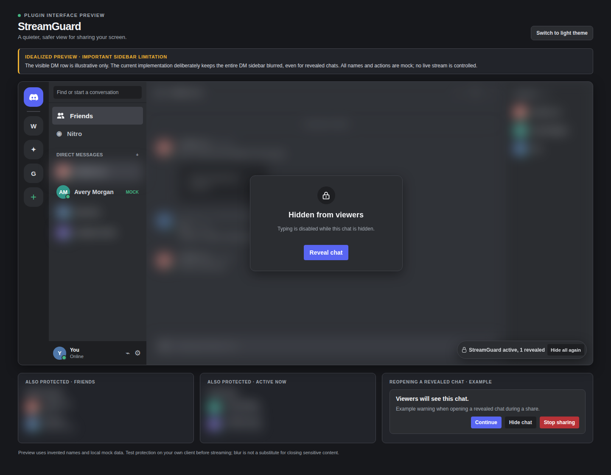

# This plugin is generally safe and is not intended to violate Discord's rules. However, you use it at your own risk.

# StreamGuard

<sup>**EXPERIMENTAL RELEASE · v0.1.0**</sup>

StreamGuard is publicly available for testing and feedback. It is experimental privacy software, not a guaranteed privacy or screen-sharing protection tool. Please read the limitations below before installing.

> **Already have Vencord or Equicord built from source?** Skip steps 1 and 2 below. Go straight to [Add StreamGuard](#3-add-streamguard). Move the extracted `streamguard-plugin-main` folder directly into `src/userplugins`—do not copy its files individually. Then run `pnpm build` and restart Discord. Run `pnpm inject` only if your source build has not been injected into Discord yet.

> **Privacy warning: experimental; do not rely on StreamGuard to protect private information.** The project author reports that it works on both Equicord and Vencord. The build and mock-test results in this repository are not an independent live-client verification. There is no guarantee that selectors match every client version, that blur is unreadable, or that every sensitive surface is covered. Do not expose private content to an audience, screen recording, or screenshots on the assumption that this plugin will hide it. Close sensitive content and use Discord and operating-system controls instead.
>
> **Notifications are not suppressed on either client.** The suppression setting is present and defaults to on, but the implementation cannot change notification settings: restore is a no-op. Manually disable or mute Discord popups, sounds, desktop/system notifications, and notifications from other plugins or applications before sharing.

StreamGuard is a single-source user plugin for the pinned Equicord and Vencord trees described in [COMPATIBILITY.md](COMPATIBILITY.md). It attempts to blur identified private-chat areas when your own Discord screen share starts, or when manually enabled, and provides temporary per-chat reveals. Blur changes presentation only; it does not remove or modify message data. There are no plugin network requests or telemetry in the supplied source.

> The screenshot below is a static mockup with invented names and data; it is not a live-client screenshot.



## Install

StreamGuard requires a **Vencord or Equicord source build**. Follow the steps for your client below.

### 1. Install the required tools (Windows)

Install these first:

- [Git for Windows](https://git-scm.com/install/win) — download and run the installer.
- [Node.js LTS](https://nodejs.org/en/download/) — download the Windows Installer (.msi) and run it.
- [pnpm](https://pnpm.io/installation) — after installing Node.js, open PowerShell and run:

  ```powershell
  npm install --global pnpm
  ```

Close and reopen PowerShell, then check that all tools are available:

```powershell
git --version
node --version
pnpm --version
```

### 2. Download and set up Vencord or Equicord

Choose **one** client. Open PowerShell in the folder where you want to keep its source.

**Vencord**

```powershell
git clone https://github.com/Vendicated/Vencord.git
cd Vencord
```

**Equicord**

```powershell
git clone https://github.com/Equicord/Equicord.git
cd Equicord
```

Install dependencies, build the client, and inject it into Discord:

```powershell
pnpm install --frozen-lockfile
pnpm build
pnpm inject
```

The first build prepares the client. The installer opened by `pnpm inject` will let you select the Discord installation to patch. Complete that step before adding the plugin.

### 3. Add StreamGuard

1. Download the [StreamGuard ZIP](https://github.com/d12w/streamguard-plugin/archive/refs/heads/main.zip) and extract it.
2. Open the extracted `streamguard-plugin-main` folder's parent location. You should see the `streamguard-plugin-main` folder inside it.
3. Move that entire `streamguard-plugin-main` folder directly into your Vencord/Equicord source folder's `src/userplugins` directory. If `userplugins` does not exist, create it first.

That's it—**do not open the folder to copy its files, do not create another folder, and do not rename it.** The result should look like this:

```text
src/userplugins/streamguard-plugin-main/
├── index.tsx
├── logic.ts
├── compat.ts
└── styles.css
```

### 4. Build and launch

Open PowerShell in the Vencord/Equicord source folder and run:

```powershell
pnpm build
```

Then fully close Discord (including its system-tray process) and open it again. StreamGuard should appear in the client mod's Plugins settings; enable it there.

You normally do **not** need to run `pnpm inject` again after adding or updating a user plugin if this source build is already injected. Rebuild with `pnpm build` and restart Discord.

### Already have Vencord or Equicord from source?

Skip steps 1 and 2. Download and extract the StreamGuard ZIP, then move the entire `streamguard-plugin-main` folder into your existing `src/userplugins` directory. If `userplugins` does not exist, create it first. Do not copy the files individually. Run `pnpm build` from the client source folder and restart Discord. If the source build has not been injected into Discord yet, run `pnpm inject` once.

To update StreamGuard later, remove the existing `src/userplugins/streamguard-plugin-main` folder, move the newly extracted `streamguard-plugin-main` folder into `src/userplugins`, run `pnpm build`, and restart Discord.

## Use and reset

1. **Before any live sharing**, manually disable/mute notifications and test using non-sensitive fake content with no audience or live stream. With StreamGuard enabled, enter `/streamguard` to toggle manual protection on. Inspect the sidebar, friends/activity sections, hidden chat, composer, overlay, and indicator. Try the context-menu actions and `/streamguard-panic`. This is only a smoke test, not proof that screenshares or screenshots are safe. If anything is unexpected, stop and do not share private content.
2. With protection active, right-click a DM, group DM, or a user with an existing DM and choose **Reveal chat** when the item is available, or use **Reveal chat** on the hidden-chat overlay. Context-menu availability depends on Discord supplying a recognizable private channel. The selected chat may become readable; opening/revealing it while an own stream is known can first trigger the safety mode below. A revealed chat is intentionally visible to viewers: do not reveal anything you do not want them to see.
3. **Important:** the *entire DM sidebar stays blurred even for revealed chats*. The code deliberately leaves the sidebar in its conservative fallback because it cannot prove that all virtualized rows are mapped. Thus the requested per-chat sidebar reveal is not implemented. Revealing affects the selected chat view when identified; it does not unblur its sidebar row. The friends list and Active Now section also remain blurred while active when identified.
4. Right-click and choose **Hide chat** to remove that conversation's reveal. Use the indicator's **Hide all again** button, or `/streamguard-panic`, to clear all current reveals and re-hide them. Panic also clears any in-memory allowlist exceptions. It keeps manual protection on if it was already on, or turns it on if protection was inactive; when protection was automatic only, it stays automatic. These controls are not a substitute for stopping the share.
5. `/streamguard` toggles the *manual* flag, not the automatic setting. Turning manual off does not turn protection off if an own stream is still tracked and auto-enable is on, or if fail-safe is latched. The toast reports the manual flag, not a guarantee of protection.

The indicator contains a reveal count rather than chat names. For a recognized hidden chat, the overlay says **Hidden from viewers** and offers **Reveal chat**. By default the plugin attempts to block typing and submission through pointer and input-event interception; it is not a guaranteed native disabled state. Enable typing only if you understand the risk. A reveal is temporary and held in memory, not a persistent allowlist. Although the pure state machine has allowlist support, there is **no allowlist UI or persistence integration** in this plugin.

### Reset behavior

- A timed reveal expires after its selected deadline; changing the duration setting does not retroactively change an existing reveal.
- The last tracked own stream ending clears **all** temporary reveals, including timed ones; ending one of multiple tracked streams does not clear them while another remains. Manual protection can remain on after the share ends.
- Reveals are cleared when the `/streamguard` manual toggle turns active protection off, on account change, plugin stop/disable, reload/restart, panic/hide-all, or a fail-safe trigger. **Hide chat** removes that chat's reveal. A known recipient change/removal also removes its recorded reveal when the relevant store update and recipient data are available; this is not a coverage guarantee.
- Changing Auto-enable off clears temporary reveals if that change deactivates protection. A snapshot that replaces all previously known stream keys with unrelated keys also clears reveals, because stream continuity cannot be established.
- Reload creates a fresh in-memory plugin state and attempts to read the current stream snapshot. Reveals, prior warning approvals, and the manual toggle are not restored. The standalone logic test's simulated restore is not a live Discord reload test. If the snapshot is unreadable, the plugin latches fail-safe and warns; a valid-looking but not-yet-hydrated empty snapshot can still be mistaken for no stream.
- In fail-safe, reveals are blocked and fail-safe protection is latched even if the manual flag is toggled. There is no user-facing recovery command. Stop sharing manually, verify it has actually ended, and restart the plugin if you choose to clear the fail-safe. Disabling/restarting the plugin removes its blur and UI, so do not do that while depending on it for privacy.

## Settings

Settings descriptions are English. Defaults below are from the supplied code.

| Setting | Default | Effect and limitation |
| --- | --- | --- |
| Auto-enable on screen share (`autoEnable`) | On | Tracks own `STREAM_CREATE` / `STREAM_DELETE` events and attempts protection while at least one own stream is active. With this off, use manual mode. Detection is not proven in a live client and can race with stream startup. |
| Blur strength (`blurStrength`) | 18 px | Slider at 14, 18, 22, 26, or 30 px; applied to recognized sections. Stronger blur is not a guarantee of unreadability. |
| Also blur servers (`blurServers`) | Off | Attempts to blur the identified server rail. It is not comprehensive protection of server content or names elsewhere. |
| Reveal duration (`revealDuration`) | Until the stream ends | Also offers 5 minutes, 15 minutes, and 1 hour. With no tracked stream, the default open-ended choice falls back to **1 hour** in manual-only mode. Any last-stream end or protection reset can clear a timed reveal earlier. |
| Allow typing in hidden chats (`allowTyping`) | Off | When off, attempts to block input and shows a hint; when on, attempts to allow composer interaction while the recognized chat stays blurred. Neither setting guarantees input blocking or concealment. |
| When opening a revealed chat during a share (`safetyMode`) | **Warn me** | **Do nothing** allows the reveal without a warning; **Warn me** attempts a confirmation with **Continue**, **Hide chat**, and **Stop sharing**; **Stop sharing automatically** attempts to request stops before showing the chat. The safety decision applies when a stream is tracked, including if auto-enable is off but manual protection is on. Manual-only mode with no tracked stream does not show the warning. If the warning cannot open, the code attempts to keep the chat hidden. |
| Fail-safe stop (`failSafe`) | On | On a later animation frame, checks a CSS probe, body active marker, and the existence of the recognized selected-chat/private-list containers where applicable. On failure it latches hidden state, warns, and **requests** stops for known own streams. It does not verify every surface, visual unreadability, capture output, or that any stream actually stops. It may not detect a selector that points to the wrong element. |
| Suppress notifications while sharing (`suppressNotifications`) | On, **unavailable** | The setting causes a warning when protection is active; it does not suppress notifications or sounds, change settings, or save prior settings on either client. Turning it off only disables the attempted suppression/warning. Restore is a no-op. Mute/disable notifications yourself. |
| Show floating indicator (`showIndicator`) | On | Attempts to show the status/count and **Hide all again** control. Hiding the indicator does not disable protection. |

The stop-sharing function uses a runtime Discord action lookup. A successful call means only that a stop was **requested**, not confirmed. It waits for a tracked stream to end; after five seconds without confirmation, it warns and enters fail-safe. Missing actions, asynchronous results, rejected calls, stale stream state, and other failures can prevent stopping. **Always check Discord's share controls and stop sharing manually when uncertain.** If no stream is known, there may be no stop request at all.

## Important coverage limitations

Discord's hashed classes, DOM structure, stores, and actions can change. Guard activation, stream detection, DOM scanning and blur are not atomic with stream startup; sensitive content may appear before any protection attaches. The first matching chat container may not be the selected conversation, and navigation can temporarily expose a stale or incoming chat because the route and DOM do not change atomically. The overlay is opaque over a recognized hidden chat, but can still be attached to the wrong container or be bypassed by other UI layers. CSS only affects marked DOM in this client and cannot ensure capture privacy. Search and jump results, popouts, pinned messages, threads, calls/voice and video surfaces, notifications, system toasts, overlays, other apps, and other windows may expose content. Images, videos, embeds, authors, mentions and reply previews are only obscured if they actually lie inside a correctly identified and protected region. Screenshot and screen-stream output have not been tested. Do not infer safety from a pill, toast, or successful build.

The files [docs/preview.html](docs/preview.html) and [docs/preview.png](docs/preview.png) use fake data and are **idealized static mockups**, not exact product behavior. In particular, the preview shows a revealed sidebar row while the actual implementation keeps the whole DM sidebar blurred.

## Tests and compatibility

From this folder, with Node 22.18 or later, run:

```sh
node --test tests/logic.test.cjs
# Optional browser smoke tests: point to an installed checkout and Chromium.
STREAMGUARD_DEPS_ROOT=/path/to/Vencord CHROMIUM_PATH=/usr/bin/chromium \
  node --test tests/integration.smoke.test.cjs
```

The pure logic suite passed 25 tests in the development environment. A separate Chromium suite exercises the plugin against a synthetic DOM and mocked Discord APIs; it is not a Discord integration test. See [COMPATIBILITY.md](COMPATIBILITY.md) and [TEST_RESULTS.md](TEST_RESULTS.md) for scope and results.

## License

This project is distributed under the GNU General Public License v3.0 or later; see [LICENSE](LICENSE). StreamGuard is an independent user plugin and is not affiliated with Discord, Equicord, or Vencord.
